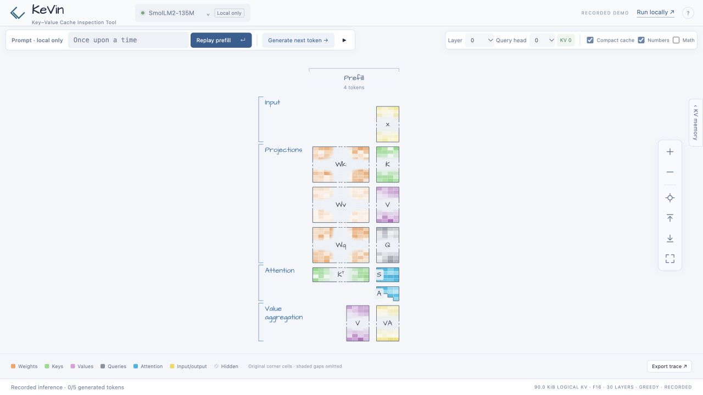
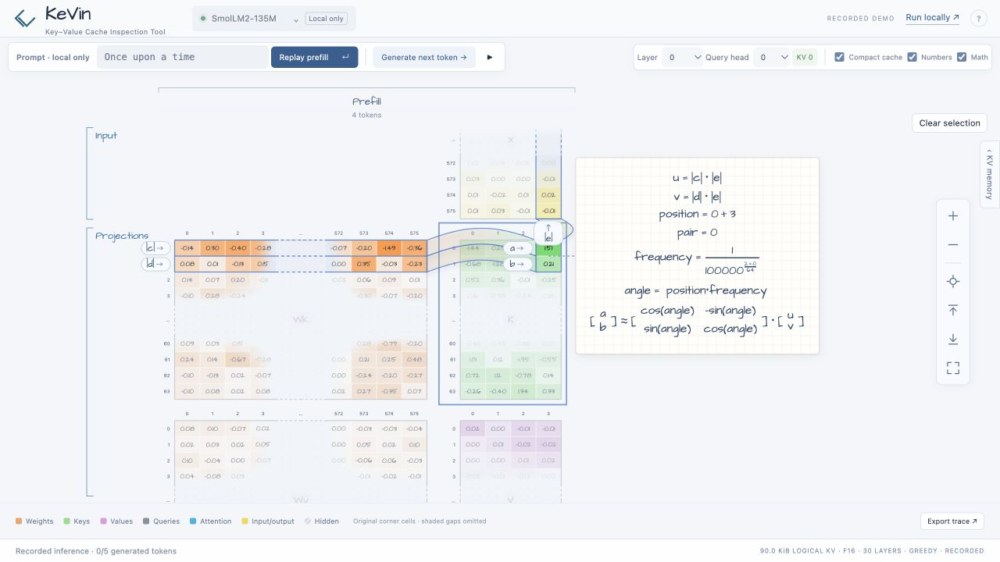

# KeVin

**Key–Value Cache Inspection Tool.** KeVin (pronounced “Kevin”) is a standalone, local explorer of a real pretrained language model's KV cache. No training and no fabricated model activations.

**[Try the web demo](https://imruljubair.github.io/KeVin/)** ·
**[Run locally](https://imruljubair.github.io/KeVin/run-locally.html)**

The web edition explores recorded SmolLM2 135M inference with a fixed prompt
and five generated tokens. All 30 layers and 9 query heads are available.
Run locally for your own prompts, other supported models, and live generation.
See [web demo development and publication](docs/web-demo.md).

Explore the prefill/decode timeline, real attention matrices, and growing KV
cache. Large matrices retain their original corner values with two-row or
two-column omitted bands; no values are averaged. Matrix indices start at zero.
Click a matrix to focus at 85%, or use Overview to fit the whole diagram.

- **Compact cache** shares the growing K/V operands across decode steps.
- **Numbers** displays actual corner values when zoomed in.
- **Math** enables cell and matrix calculation cards; it starts unchecked.
  RoPE selections highlight both paired outputs and show their 2 × 2 rotation.
- **KV memory** opens a resizable panel with token slots, feature indices, and
  logical FP16 byte counts. It starts collapsed.



**Fonts:** Architects Daughter is the active style. The original style is preserved
behind an internal code setting; see [appearance and undo/redo](docs/appearance.md).

The frontend uses React + D3 with Canvas/SVG matrix rendering. The compiled
bundle is included, so `python3 -m kevin` still works without installing Node.js.
For frontend development and the saved original implementation, see
[React + D3 and restoration](docs/react-d3.md).

## Start

Requires Python 3.10+, Git, CMake 3.20+, and a C++17 compiler. On macOS, install the Xcode command line tools if needed. The Python server uses the standard library; running the app needs no pip or npm installation.

```bash
git clone https://github.com/imruljubair/KeVin.git
cd KeVin
python3 scripts/setup.py
./start
```

Open <http://127.0.0.1:8765>. `./start` forwards server options, for example `./start --port 0`. On macOS, `run.command` also starts an already built app.

If port 8765 is already in use, KeVin may already be running; open that URL instead of launching it again. To start a separate instance on an available port, run `./start --port 0` and open the URL it prints.

1. Click **Choose a model**.
2. Choose a model (or select **Use a GGUF link…**) and click **Load model**. Compatibility checks run automatically before downloading.
3. Enter a short prompt and click **Prefill**.
4. **Generate next token** adds a decode column. Play continues until paused, end of sequence, or the context limit.
5. Change layer/query head without rerunning the model. Enable **Math** to inspect cells or click matrix names for their formulas.

Recommended first model:

```text
https://huggingface.co/ggml-org/SmolLM2-135M-GGUF/resolve/main/SmolLM2-135M-Q8_0.gguf
```

This is a public GGUF conversion of [HuggingFaceTB/SmolLM2-135M](https://huggingface.co/HuggingFaceTB/SmolLM2-135M), a pretrained model with 30 layers, 9 query heads, 3 KV heads, and 64 components per head. Its base-model output is text continuation. Generation uses greedy decoding.

To start with a local file:

```bash
python3 -m kevin --model models/SmolLM2-135M-Q8_0.gguf
```

The app runs one shared local model/session. Different browser tabs use that same session. Downloads are stored in `models/` and reused. The server listens only on loopback. Restarting requires selecting the model again, or passing `--model`; restarting does not redownload cached files.

## What the colors mean

- **Orange:** real Wq/Wk/Wv weights for the selected query/KV heads, dequantized from GGUF storage.
- **Green:** actual cached keys, after rotary position encoding and the F16 cache write.
- **Purple:** actual cached values, after the F16 cache write.
- **Gray:** post-RoPE query operands.
- **Cyan:** actual softmax attention probabilities. Future positions are masked.
- **Yellow:** normalized input and per-head attention output before the output projection.

Kᵀ sits beside raw Scores, followed by column-wise softmax A; V sits beside VA.
In compact mode, shared cache operands grow by appending every generated
position after the fixed prefill proxy. In non-compact mode, decode columns
show only their added key rows and value columns; earlier slices remain in
place. Query heads in the same GQA group share Wk/Wv and cached K/V.

Proxies retain at most four real cells at each edge. A 32 × 64 matrix retains
three rows at each end and four columns at each end: an 8 × 10 display with
two omitted slots on each compressed axis. The hidden bands represent original
index ranges, not averages or sample values. Shading fades toward the center.
Visible values use two decimal places; hover and exports retain captured
precision. Architects Daughter is bundled locally.

Enable **Math** for calculation ribbons and graph-paper formula cards. Selecting
K or Q highlights both RoPE partners as `a` and `b`, traces weight operands
`|c|`, `|d|` and input `|e|`, and shows the full sine/cosine rotation matrix.
Scores, softmax A, VA, and cache copies have their own formulas. Omitted ranges
stay symbolic. Cards prefer the right side and move below the selection when
there is insufficient room. Wheel gestures over cards and variable labels pan
the diagram; Ctrl/Command+wheel zooms. Escape or **Clear selection** dismisses
an explanation. Disabling Math clears the cards and ribbons.

Click a matrix name with Math enabled to show its matrix-level equation.
See [cell and matrix math](docs/cell-math.md) for the formulas and trace metadata.



**Export trace** saves actual floating-point arrays for the selected layer/head, token IDs, timing, model source, and layout metadata. Exported activation values preserve captured precision regardless of the display mode. Weight exports contain the retained original GGUF corner values and their indices, rather than full weight matrices.

## Model gates

This first release deliberately supports a bounded set of models:

- Public, ungated Hugging Face HTTPS links to a single GGUF v2/v3 file, at most 1 GiB.
- Standard `llama` architecture, without MoE or sliding-window attention.
- F32/F16/BF16 and conventional Q4/Q5/Q8/K tensor quantizations; exotic quantizations are rejected.
- At most 48 layers, 64 query heads, equal Q/K/V head dimensions up to 256, and a valid GQA grouping.
- 128 context tokens, including the prompt. Requests stop before cache shifting or eviction.
- A conservative RAM estimate must fit within 80% of estimated available system memory.
- A real prompt smoke test must successfully capture all expected attention tensors before the model is accepted.

Metadata is inspected through bounded HTTP range reads before download, with bounded reading when the host ignores Range. Download size and metadata are checked again before loading. Compatibility checks cannot establish the provenance or training quality of an arbitrary uploaded model. **SmolLM2-135M Q8_0 is the verified starting point; other Llama GGUFs still require testing.**

The initial engine uses CPU inference with an F16 KV cache and Flash Attention disabled. This makes internal tensors inspectable and provides predictable behavior across machines. GPU acceleration, multi-session serving, split GGUFs, and additional architectures are future work. CPU decode speed depends on the model and hardware; timing shown in the app includes capture overhead, excluding HTTP/rendering overhead. Logical cache size excludes allocator padding and inspection history.

## Implementation

```text
Hugging Face GGUF
  -> Python metadata validation + local download cache
  -> persistent llama.cpp process
  -> evaluation callbacks reading real attention/cache operands
  -> graphical prefill/decode timeline
```

`engine/main.cpp` uses llama.cpp's scheduler evaluation callback. It reads bounded corner slices of the selected heads’ projection weights from the original GGUF file, because optimized CPU buffers can contain repacked weights that cannot be read back directly. This preserves inference’s optimized kernels. The original GGUF rows are dequantized with llama.cpp’s type decoders; complete weight matrices are not sent to the browser. It reads K and V from the real cache operands used by attention, Q from the actual query operand, and A/VA from their actual operations. It respects tensor strides and reads tensors before graph memory is reused. At each decode step, every existing K/V component is checked for exact preservation. All layers/heads remain available for switching, with only the selected view sent to the frontend.

llama.cpp is pinned to `67b9b0e7f6ce45d929a4411907d3c48ec719e81c`; its sources are unmodified. Setup clones it into ignored `.deps/llama.cpp`. To seed setup from another local checkout, use `python3 scripts/setup.py --llama-source /path/to/llama.cpp`.

The inference bridge is isolated in a subprocess. A failed decode invalidates its timeline, so a partial cache cannot silently contaminate later output. HTTP requests are serialized around model mutations, cross-origin writes are rejected, and there is no HTTP endpoint for loading arbitrary local paths or executing shell commands.

## Verify

```bash
python3 -m unittest discover -s tests -v
KAVIN_TEST_MODEL=models/SmolLM2-135M-Q8_0.gguf python3 -m unittest discover -s tests -v
npm ci
npm run build
npm test
python3 scripts/build_pages.py
```

The real-model tests check selected-head weight slices, GQA weight sharing, and projection products against captured pre-RoPE matrix products with CPU activation quantization accounted for. They also check attention against full-dimensional Q/K calculations and value mixtures within F16 kernel tolerance, unchanged cache prefixes, grouped-query head mapping, layer switching, reset, and cached logits against an independent full-sequence inference context. Tests without `KAVIN_TEST_MODEL` skip inference tests; metadata tests do not need downloaded weights.

Stop the server with Ctrl-C. Diagnostic inference logs are in `engine.log`.

## Logo

The interlocking teal mark is available as [SVG](web/logo.svg). The header and
browser favicon share [favicon.svg](web/favicon.svg). Design references and the
previous mark are preserved in `docs/branding/`.
