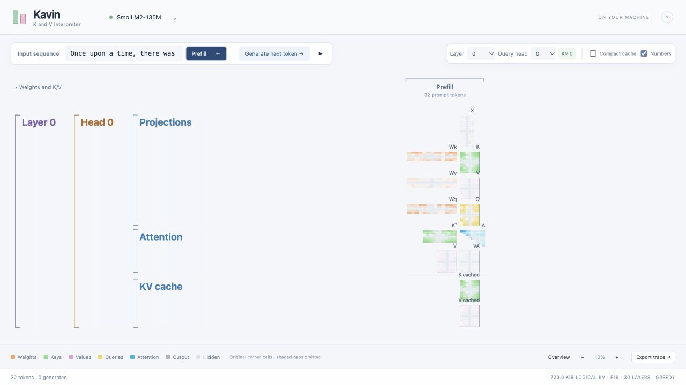
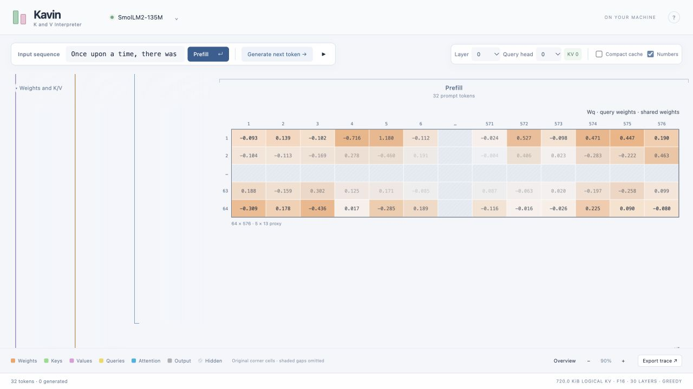

# KeVin

**Key–Value Cache Inspection Tool.** KeVin (pronounced “Kevin”) is a standalone, local explorer of a real pretrained language model's KV cache. No training and no fabricated model activations.

**[Try the web demo](https://imruljubair.github.io/KeVin/)** ·
**[Run locally](https://imruljubair.github.io/KeVin/run-locally.html)**

The web edition explores recorded SmolLM2 135M inference with a fixed prompt
and five generated tokens. All 30 layers and 9 query heads are available.
Run locally for your own prompts, other supported models, and live generation.
See [web demo development and publication](docs/web-demo.md).

KeVin uses the visualization style of `littleLLAMA/out/llama-34324/full-forward-json.html`: compact spacing, short side titles, left matrix brackets, and two-decimal values. Compact cache is enabled by default, and the initial view opens at a readable zoom; Overview still fits the entire scene. It follows littleLLAMA's prefill/decode matrix layout, alignment, pastel colors, layer/head controls, zoom/pan, and cache hierarchy. Large matrices use dimension-aware proxies: four original corner slices, fixed shaded omission bands, and cells that fade toward the hidden center. **Numbers** displays the captured components in those slices.



**Fonts:** Architects Daughter is the active style. The original style is preserved
behind an internal code setting; see [appearance and undo/redo](docs/appearance.md).

The frontend uses React + D3 with Canvas/SVG matrix rendering. The compiled
bundle is included, so `python3 -m kevin` still works without installing Node.js.
For frontend development and the saved original implementation, see
[React + D3 and restoration](docs/react-d3.md).

## Start

Requires Python 3.10+, Git, CMake 3.20+, and a C++17 compiler. On macOS, install the Xcode command line tools if needed. The Python server uses the standard library; running the app needs no pip or npm installation.

```bash
git clone https://github.com/imruljubair/KeVin.git
cd KeVin
python3 scripts/setup.py
python3 -m kevin
```

Open <http://127.0.0.1:8765>. On macOS, `run.command` also starts an already built app.

If port 8765 is already in use, KeVin may already be running; open that URL instead of launching it again. To start a separate instance on an available port, run `python3 -m kevin --port 0` and open the URL it prints.

1. Click **Choose a model**.
2. Choose a model (or select **Use a GGUF link…**) and click **Load model**. Compatibility checks run automatically before downloading.
3. Enter a short prompt and click **Prefill**.
4. **Generate next token** adds a decode column. Play continues until paused, end of sequence, or the context limit.
5. Change layer/query head without rerunning the model. Inspect a matrix to see its role and dependency links.

Recommended first model:

```text
https://huggingface.co/ggml-org/SmolLM2-135M-GGUF/resolve/main/SmolLM2-135M-Q8_0.gguf
```

This is a public GGUF conversion of [HuggingFaceTB/SmolLM2-135M](https://huggingface.co/HuggingFaceTB/SmolLM2-135M), a pretrained model with 30 layers, 9 query heads, 3 KV heads, and 64 components per head. Its base-model output is text continuation. Generation uses greedy decoding.

To start with a local file:

```bash
python3 -m kevin --model models/SmolLM2-135M-Q8_0.gguf
```

The app runs one shared local model/session. Different browser tabs use that same session. Downloads are stored in `models/` and reused. The server listens only on loopback. Restarting requires selecting the model again, or passing `--model`; restarting does not redownload cached files.

## What the colors mean

- **Orange:** real Wq/Wk/Wv weights for the selected query/KV heads, dequantized from GGUF storage.
- **Green:** actual cached keys, after rotary position encoding and the F16 cache write.
- **Pink:** actual cached values, after the F16 cache write.
- **Yellow:** the current query operands.
- **Cyan:** actual softmax attention probabilities. Future positions are masked.
- **Gray:** actual per-head attention output, before the output projection.

Kᵀ sits beside raw Scores, followed by column-wise softmax A; V sits beside VA. There is no duplicate cache section underneath. The right-side memory panel shows K/V slots and FP16 byte counts for the selected layer/KV head. Click a slot or token header to connect it to the diagram; Show values reveals two-decimal values, and the left panel edge can be dragged to resize it. In non-compact mode, each decode column shows only the new key row and value/cache columns, with their original coordinates. Earlier entries remain in their earlier columns. Appended strips have one simple outer outline; shared caches use a single boundary line, without per-cell append borders.

Each block preserves the matrix's orientation and uses a bounded proxy whose width and height grow with the original dimensions. Corner sizes follow the square-root ratio of rows to columns, with a budget of eight edge cells split between the two axes (two to six per axis). A 32 × 64 matrix retains three rows at each end and five columns at each end, yielding a 7 × 11 proxy including omission bands. Smaller prefill axes appear in full without duplicated entries. After prefill, its sampled indices, omitted ranges, cell sizes, and fading stay fixed. Every generated token is appended visibly; no additional token positions are hidden as the cache grows. Original indices identify every retained component; no values are averaged or invented. Fixed shaded bands represent omitted ranges, and retained cells fade toward them.

**Numbers** hides or shows labels without changing the proxy geometry. Displayed values use exactly two decimal places, including trailing zeros, matching the littleLLAMA reference. Values below 0.005 in magnitude display as 0.00; inspection and exports retain the full captured precision. Click a matrix to focus it with a smooth 340 ms zoom; hover or click a retained cell to inspect its full captured value and original coordinates. Clicking a shaded gap explains its omitted ranges. Color scales stay fixed across steps: signed activations use tanh with scale 0.35; attention uses square-root probability intensity.

**Compact cache** displays one shared growing K/V cache: the fixed prefill proxy followed by every generated row/column. Each attention calculation retains its original token prefix. X and Q are always visible above attention. **Weights and K/V** expands the shared Wq/Wk/Wv blocks and K/V projections; this section is open initially. X is the actual normalized input. Each weight block uses the same corner proxy and shading as activation matrices, with original indices and no averaging. Weight blocks appear once and are reused across token steps. Query heads in the same GQA group share Wk/Wv. Short matrix labels match littleLLAMA; the inspector explains RoPE and the F16 cache write. Layer, Head, and section brackets follow littleLLAMA’s hierarchy, with square matrix outlines and dark monospaced values. Full-dimension rendering is not included.



Click **Scores**, **A**, or **VA**, or an individual retained cell, to inspect its math connections. Operand ranges are outlined and connected with solid lines; omitted portions use dashed outlines and connections. The inspector shows the softmax or weighted-sum formula. Scores connect the selected key row and query column. Softmax connects every causally visible score in that column, and weighted sums include the full visible token prefix, including hidden proxy spans. In non-compact mode, connections resolve the earlier cache slices across decode columns. Clicking a shaded region traces its index ranges without inventing a numerical value. Cache copy and transpose connections are also available. Selecting Q/K/V traces its full X column and relevant weight rows, including RoPE partners and hidden components. Selecting weights shows their use in the latest step. Blue orthogonal routes avoid unrelated matrix interiors, following littleLLAMA’s connector style. Click-to-zoom keeps the relevant operands in view; **Focus matrix** isolates one block.

**Export trace** saves actual floating-point arrays for the selected layer/head, token IDs, timing, model source, and layout metadata. Exported activation values preserve captured precision regardless of the display mode. Weight exports contain the retained original GGUF corner values and their indices, rather than full weight matrices.

## Model gates

This first release deliberately supports a bounded set of models:

- Public, ungated Hugging Face HTTPS links to a single GGUF v2/v3 file, at most 1 GiB.
- Standard `llama` architecture, without MoE or sliding-window attention.
- F32/F16/BF16 and conventional Q4/Q5/Q8/K tensor quantizations; exotic quantizations are rejected.
- At most 48 layers, 64 query heads, equal Q/K/V head dimensions up to 256, and a valid GQA grouping.
- 128 context tokens, including the prompt. Requests stop before cache shifting or eviction.
- A conservative RAM estimate must fit within 80% of estimated available system memory.
- A real prompt smoke test must successfully capture all expected attention tensors before the model is accepted.

Metadata is inspected through bounded HTTP range reads before download, with bounded reading when the host ignores Range. Download size and metadata are checked again before loading. Compatibility checks cannot establish the provenance or training quality of an arbitrary uploaded model. **SmolLM2-135M Q8_0 is the verified starting point; other Llama GGUFs still require testing.**

The initial engine uses CPU inference with an F16 KV cache and Flash Attention disabled. This makes internal tensors inspectable and provides predictable behavior across machines. GPU acceleration, multi-session serving, split GGUFs, and additional architectures are future work. CPU decode speed depends on the model and hardware; timing shown in the app includes capture overhead, excluding HTTP/rendering overhead. Logical cache size excludes allocator padding and inspection history.

## Implementation

```text
Hugging Face GGUF
  -> Python metadata validation + local download cache
  -> persistent llama.cpp process
  -> evaluation callbacks reading real attention/cache operands
  -> graphical prefill/decode timeline
```

`engine/main.cpp` uses llama.cpp's scheduler evaluation callback. It reads bounded corner slices of the selected heads’ projection weights from the original GGUF file, because optimized CPU buffers can contain repacked weights that cannot be read back directly. This preserves inference’s optimized kernels. The original GGUF rows are dequantized with llama.cpp’s type decoders; complete weight matrices are not sent to the browser. It reads K and V from the real cache operands used by attention, Q from the actual query operand, and A/VA from their actual operations. It respects tensor strides and reads tensors before graph memory is reused. At each decode step, every existing K/V component is checked for exact preservation. All layers/heads remain available for switching, with only the selected view sent to the frontend.

llama.cpp is pinned to `67b9b0e7f6ce45d929a4411907d3c48ec719e81c`; its sources are unmodified. Setup clones it into ignored `.deps/llama.cpp`. To seed setup from another local checkout, use `python3 scripts/setup.py --llama-source /path/to/llama.cpp`.

The inference bridge is isolated in a subprocess. A failed decode invalidates its timeline, so a partial cache cannot silently contaminate later output. HTTP requests are serialized around model mutations, cross-origin writes are rejected, and there is no HTTP endpoint for loading arbitrary local paths or executing shell commands.

## Verify

```bash
python3 -m unittest discover -s tests -v
KAVIN_TEST_MODEL=models/SmolLM2-135M-Q8_0.gguf python3 -m unittest discover -s tests -v
node --check web/app.js
node --test tests/matrix_proxy.test.cjs
```

The real-model tests check selected-head weight slices, GQA weight sharing, and projection products against captured pre-RoPE matrix products with CPU activation quantization accounted for. They also check attention against full-dimensional Q/K calculations and value mixtures within F16 kernel tolerance, unchanged cache prefixes, grouped-query head mapping, layer switching, reset, and cached logits against an independent full-sequence inference context. Tests without `KAVIN_TEST_MODEL` skip inference tests; metadata tests do not need downloaded weights.

Stop the server with Ctrl-C. Diagnostic inference logs are in `engine.log`.
